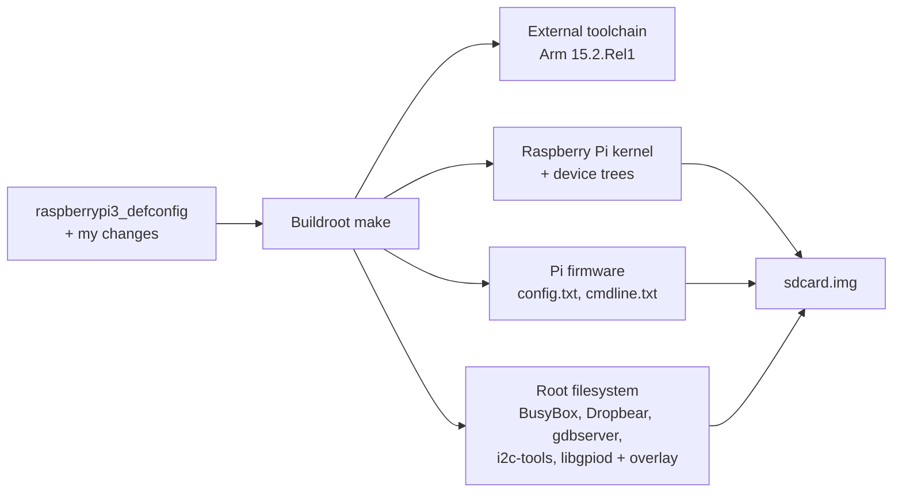
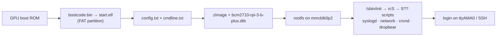

# Raspberry Pi 3 B+ with Buildroot

A custom embedded Linux system for the **Raspberry Pi 3 Model B+**, built with **Buildroot 2026.08** and the
**Arm GNU Toolchain 15.2.Rel1**, ready for **SSH**, **remote debugging** and **Eclipse** cross-development.

This guide records the exact setup that was built and tested on real hardware.


-red)


**Result:**

- 32-bit Linux image on a microSD card (Raspberry Pi kernel, BusyBox, BusyBox init)
- Serial console on the GPIO header (`ttyAMA0`, 115200) via an FT232R USB-TTL adapter
- Static IP **192.168.7.3** (rootfs overlay)
- **SSH** with Dropbear
- **gdbserver** on the board + cross **gdb** on the laptop, for Eclipse
- **i2c-tools** and **libgpiod** (+ tools) for hardware projects

---

## Table of Contents

1. [The Big Picture](#1-the-big-picture)
2. [What You Need](#2-what-you-need)
3. [Workspace Layout](#3-workspace-layout)
4. [Get Buildroot (Shared Source)](#4-get-buildroot-shared-source)
5. [Create the Overlay](#5-create-the-overlay)
6. [Configure Buildroot](#6-configure-buildroot)
7. [Save the Configuration](#7-save-the-configuration)
8. [Build](#8-build)
9. [Write the SD Card](#9-write-the-sd-card)
10. [Check the SD Card](#10-check-the-sd-card)
11. [Serial Console](#11-serial-console)
12. [First Boot and Login](#12-first-boot-and-login)
13. [Network: Direct Cable or LAN Switch](#13-network-direct-cable-or-lan-switch)
14. [SSH](#14-ssh)
15. [Ready for Eclipse](#15-ready-for-eclipse)
16. [Daily Use and Rebuilds](#16-daily-use-and-rebuilds)
17. [Building the UDOO from the Same Buildroot](#17-building-the-udoo-from-the-same-buildroot)
18. [UDOO vs Raspberry Pi](#18-udoo-vs-raspberry-pi)
19. [References](#19-references)

- Writing, deploying and debugging applications: **[docs/eclipse-setup.md](docs/eclipse-setup.md)**
- GPIO, pinctrl, device tree and SoC concepts (Q&A): **[docs/gpio-and-pinctrl-concepts.md](docs/gpio-and-pinctrl-concepts.md)**
- Problems met and how they were solved: **[docs/troubleshooting.md](docs/troubleshooting.md)**

---

## 1. The Big Picture

### What Buildroot builds



### How the Pi 3 B+ boots

The Pi boots differently from the UDOO: the **GPU** starts first, and there is **no U-Boot**.



### The setup

```
  +--------------------------+   Ethernet (direct or via switch)   +----------------------+
  |         Laptop           |-------------------------------------|  Raspberry Pi 3 B+   |
  |  enp4s0: 192.168.7.1     |                                     |  eth0: 192.168.7.3   |
  |  (+ LAN IP if on switch) |   FT232R USB-TTL (3.3 V)            |                      |
  |  /dev/ttyUSB0            |-------------------------------------|  ttyAMA0 (GPIO 14/15)|
  +--------------------------+                                     +----------------------+
```

---

## 2. What You Need

### Hardware

| Item | Notes |
|---|---|
| Raspberry Pi 3 Model B+ | 5 V / 2.5 A micro-USB power supply |
| microSD card | 4 GB or more (a 7.4 GB card was used) |
| Ethernet cable | Direct to the laptop, or via a LAN switch |
| **FT232R USB-TTL adapter** | Voltage jumper set to **3.3 V**, 3 jumper wires |

> ⚠️ The Pi's GPIO pins are **3.3 V**. A 5 V serial signal can damage them.

### Software

| Software | Version |
|---|---|
| Host OS | Ubuntu 24.04 |
| Buildroot | 2026.08 - <https://buildroot.org/download.html> |
| Toolchain | Arm GNU Toolchain 15.2.Rel1 (`arm-none-linux-gnueabihf`), selected inside Buildroot |

Host packages:

```bash
sudo apt install build-essential sed make binutils diffutils gcc g++ bash patch \
    gzip bzip2 perl tar cpio unzip rsync file bc findutils wget libncurses-dev \
    picocom
```

---

## 3. Workspace Layout

All work lives under `~/Embedded_Linux/` (`Tools/`, `Udoo_Workspace/`, `Rpi_Workspace/`); `~/Tools`,
`~/Udoo_Workspace` and `~/Rpi_Workspace` are symbolic links to those folders.

**One Buildroot source** is shared by every board. Each board gets its **own output folder** (`O=`),
so the UDOO and the Pi never overwrite each other.

```
~/Tools/
├── buildroot-2026.08/            Shared Buildroot source - never built in directly
└── buildroot-dl/                 Shared download cache (all boards reuse it)

~/Rpi_Workspace/
├── br-rpi3/                      Pi build output: .config, images/, host/, target/
├── rpi3-embedded-linux/          This Git repo: guide, overlay, saved config, apps/
└── eclipse-workspace/            Eclipse settings (projects live in this repo under apps/)

~/Udoo_Workspace/
└── br-udoo/                      UDOO build output (same Buildroot source)
```

| Folder | Why |
|---|---|
| `~/Tools/buildroot-2026.08` | Clean source, shared - one download of Buildroot for all boards |
| `~/Tools/buildroot-dl` | Source archives downloaded once, reused by every board and rebuild |
| `~/Rpi_Workspace/br-rpi3` | Everything the Pi build creates. Delete it to start over - downloads stay |
| `rpi3-embedded-linux` | Only my own files go into Git |

> **Rule:** never run `make` inside `~/Tools/buildroot-2026.08` without `O=`. Run all Pi commands in `~/Rpi_Workspace/br-rpi3`.

---

## 4. Get Buildroot (Shared Source)

```bash
mkdir -p ~/Tools/buildroot-dl ~/Rpi_Workspace/eclipse-workspace
cd ~/Tools
tar xf ~/Downloads/buildroot-2026.08.tar.xz
```

Find the Pi 3 configs:

```bash
cd ~/Tools/buildroot-2026.08
ls configs | grep raspberrypi3
```

| Config | Mode | Used? |
|---|---|---|
| **`raspberrypi3_defconfig`** | 32-bit ARM, hard-float | ✅ Matches the Arm `arm-none-linux-gnueabihf` toolchain, the course (BeagleBone) and the UDOO |
| `raspberrypi3_64_defconfig` | 64-bit AArch64 | Would need the `aarch64-none-linux-gnu` toolchain |

Both support the Pi 3 B+.

Load it into the Pi's output folder:

```bash
make O=~/Rpi_Workspace/br-rpi3 raspberrypi3_defconfig
```

Check it loaded correctly:

```bash
grep -E "BR2_DEFCONFIG|BR2_cortex_a53|BR2_LINUX_KERNEL_INTREE_DTS_NAME" ~/Rpi_Workspace/br-rpi3/.config
```

```
BR2_cortex_a53=y
BR2_DEFCONFIG=".../configs/raspberrypi3_defconfig"
BR2_LINUX_KERNEL_INTREE_DTS_NAME="broadcom/bcm2710-rpi-3-b broadcom/bcm2710-rpi-3-b-plus broadcom/bcm2710-rpi-cm3"
```

---

## 5. Create the Overlay

A **rootfs overlay** is a normal folder whose files Buildroot copies into the root filesystem at the same paths.

```
~/Rpi_Workspace/rpi3-embedded-linux/overlay/etc/network/interfaces  →  /etc/network/interfaces on the Pi
```

```bash
mkdir -p ~/Rpi_Workspace/rpi3-embedded-linux/overlay/etc/network
mkdir -p ~/Rpi_Workspace/rpi3-embedded-linux/configs
```

[`overlay/etc/network/interfaces`](overlay/etc/network/interfaces):

```
auto lo
iface lo inet loopback

auto eth0
iface eth0 inet static
    address 192.168.7.3
    netmask 255.255.255.0
    network 192.168.7.0
    broadcast 192.168.7.255
    pre-up for i in 1 2 3 4 5 6 7 8 9 10; do [ -e /sys/class/net/eth0 ] && break; sleep 1; done
```

Buildroot's `/etc/init.d/S40network` runs `ifup -a`, which reads this file - the same mechanism used on the UDOO.

**Why the `pre-up` wait:** the Pi 3 B+'s Ethernet is a **USB chip** (LAN7515, driver `lan78xx`). The boot log shows
it appearing *after* `Starting network:` has begun. The wait gives `eth0` up to 10 seconds to appear.

---

## 6. Configure Buildroot

```bash
cd ~/Rpi_Workspace/br-rpi3
make menuconfig
```

> **menuconfig tips:** arrow keys move, **Enter** opens a menu or text box, **Space** toggles `[*]`,
> **`/`** searches for an option (then press the number shown to jump to it), **Esc Esc** goes back.

### Target options (check only - set by the defconfig)

| Option | Value |
|---|---|
| Target Architecture | ARM (little endian) |
| Target Architecture Variant | cortex-A53 |
| Target ABI | EABIhf |
| Floating point strategy | NEON/VFPv4 |

### Build options

| Option | Value | Why |
|---|---|---|
| Download dir | `/home/shaman/Tools/buildroot-dl` | Shared download cache (the default `$(TOPDIR)/dl` would download into the Buildroot source) |

### Toolchain

| Option | Value | Why |
|---|---|---|
| Toolchain type | **External toolchain** | Use Arm's prebuilt compiler - no compiler build, faster |
| Toolchain | **Arm ARM 15.2.rel1** | Same toolchain as the course |
| Toolchain origin | Toolchain to be downloaded and installed | Buildroot fetches it |
| Copy gdb server to the Target | **[\*]** | Remote debugging from Eclipse |

> **"Build cross gdb for the host" is hidden** with this toolchain - that is expected.
> The Arm toolchain **already includes** a matching cross debugger (`arm-none-linux-gnueabihf-gdb`), so Buildroot
> does not offer to build another. (Searching `/` → `HOST_GDB` finds it, but jumping to it shows nothing.)

### System configuration

| Option | Value used | Why |
|---|---|---|
| System hostname | `shaman` | Shown in the login prompt |
| System banner | `Welcome to Rpi3` | Shown before login |
| Root password | *(a lab-only password)* | **Required for SSH** - Dropbear refuses empty passwords |
| Network interface to configure through DHCP | **empty** | Static IP comes from the overlay |
| Root filesystem overlay directories | `/home/shaman/Rpi_Workspace/rpi3-embedded-linux/overlay` | Adds `/etc/network/interfaces` |
| Run a getty after boot → TTY port | keep default (`console`) | Login follows `console=` in `cmdline.txt` (`ttyAMA0`) |

To type a path: select the option, press **Enter**, type the full path, press **Enter**.

### Target packages

| Menu | Package | Why |
|---|---|---|
| Networking applications | **dropbear** | SSH server |
| Networking applications | **gesftpserver** | SFTP server for `scp` (OpenSSH 9+) and Eclipse |
| Hardware handling | **i2c-tools** | `i2cdetect`, `i2cget`, `i2cset` |
| **Libraries →** Hardware handling | **libgpiod** + **install tools** | GPIO library + `gpiodetect`, `gpioinfo`, `gpioset`, `gpioget` |

> libgpiod is a **library**, so it is under **Target packages → Libraries → Hardware handling**,
> not under Target packages → Hardware handling. Quickest: `/` → `LIBGPIOD` → press the number.
> "install tools" appears just below it after enabling libgpiod.

Save and exit.

### Check before building

```bash
grep -E "DROPBEAR=|ROOT_PASSWD|SYSTEM_DHCP|ROOTFS_OVERLAY|HOSTNAME|DL_DIR" .config
grep -E "TOOLCHAIN_EXTERNAL=|TOOLCHAIN_EXTERNAL_ARM|GDB_SERVER_COPY|I2C_TOOLS=|LIBGPIOD" .config
```

| Must show | |
|---|---|
| `BR2_DL_DIR="/home/shaman/Tools/buildroot-dl"` | ✅ |
| `BR2_TARGET_GENERIC_ROOT_PASSWD="..."` (not empty) | ✅ |
| `BR2_SYSTEM_DHCP=""` | ✅ |
| `BR2_ROOTFS_OVERLAY="/home/shaman/Rpi_Workspace/rpi3-embedded-linux/overlay"` | ✅ |
| `BR2_PACKAGE_DROPBEAR=y` | ✅ |
| `BR2_TOOLCHAIN_EXTERNAL=y`, `BR2_TOOLCHAIN_EXTERNAL_ARM_ARM=y` | ✅ |
| `BR2_TOOLCHAIN_EXTERNAL_GDB_SERVER_COPY=y` | ✅ |
| `BR2_PACKAGE_I2C_TOOLS=y`, `BR2_PACKAGE_LIBGPIOD=y`, `BR2_PACKAGE_LIBGPIOD_TOOLS=y` | ✅ |

---

## 7. Save the Configuration

```bash
cd ~/Rpi_Workspace/br-rpi3
make savedefconfig BR2_DEFCONFIG=/home/shaman/Rpi_Workspace/rpi3-embedded-linux/configs/rpi3_custom_defconfig
```

The `configs/` folder must exist first, otherwise: `*** Error while saving defconfig`.

### The saved config explained

`savedefconfig` keeps only options that differ from Buildroot's defaults:

| Line | Meaning |
|---|---|
| `BR2_arm=y`, `BR2_cortex_a53=y`, `BR2_ARM_FPU_NEON_VFPV4=y` | 32-bit ARM, Pi 3 CPU, hard-float |
| `BR2_TOOLCHAIN_EXTERNAL=y` | External toolchain (Arm ARM is the default preset, so it is not listed separately) |
| `BR2_TOOLCHAIN_EXTERNAL_GDB_SERVER_COPY=y` | gdbserver on the Pi |
| `BR2_DL_DIR=...` | Shared download folder |
| `BR2_TARGET_GENERIC_HOSTNAME` / `ISSUE` / `ROOT_PASSWD` | Hostname, banner, password |
| `BR2_ROOTFS_OVERLAY=...` | My overlay |
| `BR2_ROOTFS_POST_BUILD_SCRIPT`, `..._POST_IMAGE_SCRIPT` | Pi scripts that prepare the firmware and assemble `sdcard.img` |
| `BR2_LINUX_KERNEL_CUSTOM_TARBALL_LOCATION=...raspberrypi,linux...` | **Raspberry Pi Foundation kernel** (best Pi hardware support) |
| `BR2_LINUX_KERNEL_DEFCONFIG="bcm2709"` | Pi 2/3 32-bit kernel config (like `imx_v6_v7` for the UDOO) |
| `BR2_LINUX_KERNEL_INTREE_DTS_NAME=...` | Device trees for Pi 3 B, **3 B+** and CM3 |
| `BR2_PACKAGE_RPI_FIRMWARE...`, `..._CONFIG_FILE="board/raspberrypi3/config_3.txt"` | GPU firmware and the `config.txt` template |
| `BR2_PACKAGE_DROPBEAR=y`, `I2C_TOOLS=y`, `LIBGPIOD=y`, `LIBGPIOD_TOOLS=y` | My packages |
| `BR2_TARGET_ROOTFS_EXT2_4=y`, `..._SIZE="120M"` | ext4 root filesystem, 120 MB |

> The password is stored in plain text in this file - use a lab-only password.

---

## 8. Build

```bash
cd ~/Rpi_Workspace/br-rpi3
make 2>&1 | tee build.log
```

| Part | Meaning |
|---|---|
| `make` | Run the build |
| `2>&1` | Include error messages in the output |
| `\| tee build.log` | Show the output on screen **and** save it to `build.log` |

- Run as the normal user, never `sudo make`.
- No `ARCH=` / `CROSS_COMPILE=` - Buildroot handles the toolchain.
- First build: roughly **30-60 minutes**, mostly downloads (several hundred MB - watch mobile data) and the kernel.
- Keep the laptop plugged in and awake. If the build stops, fix the cause and run the same command again - it continues.

If it fails:

```bash
tail -50 build.log
grep -i error build.log
```

### Success: the last step

The build ends with `genimage` assembling the SD card image:

```
INFO: vfat(boot.vfat): adding file 'bcm2710-rpi-3-b-plus.dtb' ...
INFO: vfat(boot.vfat): adding file 'rpi-firmware/bootcode.bin' ...
INFO: vfat(boot.vfat): adding file 'rpi-firmware/cmdline.txt' ...
INFO: vfat(boot.vfat): adding file 'rpi-firmware/config.txt' ...
INFO: vfat(boot.vfat): adding file 'rpi-firmware/start.elf' ...
INFO: vfat(boot.vfat): adding file 'zImage' ...
INFO: hdimage(sdcard.img): adding primary partition 'boot' (in MBR) from 'boot.vfat' ...
INFO: hdimage(sdcard.img): adding primary partition 'rootfs' (in MBR) from 'rootfs.ext4' ...
INFO: hdimage(sdcard.img): writing MBR
```

Check the results:

```bash
ls -lh images/sdcard.img
cat target/etc/network/interfaces          # overlay applied: 192.168.7.3
cat images/rpi-firmware/cmdline.txt        # console=ttyAMA0,115200
ls host/bin/*gdb*                          # cross debugger for Eclipse
```

---

## 9. Write the SD Card

```bash
lsblk
```

Identify the card by size and `RM = 1`:

```
sda           8:0    1   7.4G  0 disk
├─sda1        8:1    1    32M  0 part /media/shaman/boot
├─sda2        8:2    1     2G  0 part /media/shaman/root
└─sda3        8:3    1   1.6G  0 part /media/shaman/var
nvme0n1     259:0    0 476.9G  0 disk                        ← laptop drive: NEVER
```

> Writing the image **erases everything on the card**. Copy off anything you need first.

```bash
sudo umount /dev/sda1 /dev/sda2 /dev/sda3        # unmount every partition
cd ~/Rpi_Workspace/br-rpi3
sudo dd if=images/sdcard.img of=/dev/sda bs=1M conv=fsync status=progress
sync
lsblk /dev/sda
```

Result - the Buildroot layout:

```
sda      7.4G  disk
├─sda1    32M  part      boot   (FAT)
└─sda2   120M  part      rootfs (ext4)
```

The rest of the card stays unused - normal.

---

## 10. Check the SD Card

Optional, but useful before the first boot. Mount both partitions **read-only**:

```bash
sudo mkdir -p /mnt/rpiboot /mnt/rpiroot
sudo mount -o ro /dev/sda1 /mnt/rpiboot
sudo mount -o ro /dev/sda2 /mnt/rpiroot
```

### Partition 1: boot (FAT)

```bash
ls /mnt/rpiboot
```

| File | Purpose |
|---|---|
| `bootcode.bin` | GPU first-stage loader |
| `start.elf`, `fixup.dat` | GPU firmware + memory setup |
| `config.txt` | Firmware settings |
| `cmdline.txt` | Kernel command line |
| `zImage` | Linux kernel |
| `bcm2710-rpi-3-b-plus.dtb` | **My board's** device tree (3 B and CM3 versions also present; firmware picks the right one) |
| `overlays/` | Device tree overlays (I2C, UARTs...) |

The two text files as built:

```bash
cat /mnt/rpiboot/config.txt
```

```
start_file=start.elf
fixup_file=fixup.dat
kernel=zImage
disable_overscan=1
gpu_mem_256=100
gpu_mem_512=100
gpu_mem_1024=100
# Enable UART0 for serial console on ttyAMA0
dtoverlay=miniuart-bt
```

```bash
cat /mnt/rpiboot/cmdline.txt
```

```
root=/dev/mmcblk0p2 rootwait console=tty1 console=ttyAMA0,115200
```

| Setting | Meaning |
|---|---|
| `dtoverlay=miniuart-bt` | Moves Bluetooth to the mini UART and gives the GPIO pins the stable **PL011 UART** (`ttyAMA0`) |
| `root=/dev/mmcblk0p2 rootwait` | Root filesystem is partition 2 of the SD card; wait until the card is ready |
| `console=tty1 console=ttyAMA0,115200` | Kernel messages on HDMI **and** on the GPIO serial port |

### Partition 2: rootfs

```bash
cat /mnt/rpiroot/etc/network/interfaces             # my overlay
ls /mnt/rpiroot/etc/init.d/                          # rcS, S40network, S50dropbear...
ls -l /mnt/rpiroot/usr/sbin/dropbear /mnt/rpiroot/usr/bin/gdbserver
ls /mnt/rpiroot/usr/sbin/i2cdetect /mnt/rpiroot/usr/bin/gpioset
cat /mnt/rpiroot/etc/hostname /mnt/rpiroot/etc/issue
```

Unmount:

```bash
sudo umount /mnt/rpiboot /mnt/rpiroot
```

---

## 11. Serial Console

### Adapter

The FT232R appears as `/dev/ttyUSB0`:

```bash
sudo dmesg | tail
```

```
usb 1-5: Product: FT232R USB UART
usb 1-5: Manufacturer: FTDI
ftdi_sio 1-5:1.0: FTDI USB Serial Device converter detected
usb 1-5: FTDI USB Serial Device converter now attached to ttyUSB0
```

> Set the FT232R's voltage jumper to **3.3 V** before connecting it to the Pi.

### Wiring

| FT232R | Pi 3 B+ header |
|---|---|
| GND | **Pin 6** (GND) |
| RXD | **Pin 8** (GPIO14 / TXD) |
| TXD | **Pin 10** (GPIO15 / RXD) |
| VCC | **not connected** |

```
        SD card end of the board
   ┌──────────────────────────────┐
   │ pin 1 (3.3V)    pin 2 (5V)   │   pins 2, 4, 6, 8, 10 = OUTER row
   │ pin 3           pin 4 (5V)   │   never connect pins 2 or 4
   │ pin 5           pin 6 (GND)  │ ← FT232R GND
   │ pin 7           pin 8 (TXD)  │ ← FT232R RXD
   │ pin 9 (GND)     pin 10 (RXD) │ ← FT232R TXD
```

TX goes to RX, RX goes to TX. Ground must be firmly connected - a loose GND causes garbage characters.

### Open the console

```bash
sudo picocom -b 115200 /dev/ttyUSB0
```

With a log file:

```bash
sudo picocom -b 115200 --logfile rpi3-boot.log /dev/ttyUSB0
```

Exit: `Ctrl+A`, then `Ctrl+X`. Start picocom **before** powering on the Pi.

---

## 12. First Boot and Login

Insert the card, connect Ethernet and the adapter, open picocom, power on.

Boot log (end):

```
[    3.713276] VFS: Mounted root (ext4 filesystem) readonly on device 179:2.
[    3.722844] devtmpfs: mounted
[    3.737226] Run /sbin/init as init process
[    3.909000] EXT4-fs (mmcblk0p2): re-mounted ... r/w.
Saving 256 bits of creditable seed for next boot
Starting syslogd: OK
Starting klogd: OK
Running sysctl: OK
Starting network: ...
[    4.947014] usb 1-1.1.1: New USB device found, idVendor=0424, idProduct=7800
[    5.229939] lan78xx 1-1.1.1:1.0 (unnamed net_device) (uninitialized): No External EEPROM. Setting MAC Speed
Starting crond: OK
Starting dropbear sshd: OK

Welcome to Rpi3
shaman login:
```

| Line | Meaning |
|---|---|
| `Mounted root (ext4 filesystem)` | Root filesystem found on `mmcblk0p2` |
| `Run /sbin/init` | BusyBox init starts → `/etc/inittab` → `/etc/init.d/rcS` → `S??` scripts |
| `Starting network` then `lan78xx ...` | The USB Ethernet chip appears *after* the network script starts - hence the `pre-up` wait |
| `Starting dropbear sshd: OK` | SSH server running |
| `Welcome to Rpi3` / `shaman login:` | My banner and hostname |

### Log in

```
shaman login: root
Password:                 ← nothing appears while typing - normal
#
```

- Username: **`root`** - the only account Buildroot creates.
- `shaman` is the **hostname**, not a user.
- After login you are in `/root`, which is **empty** - `ls` shows nothing. Use `ls /`.

### Quick checks on the Pi

```
# uname -a                  kernel version, armv7l
# cat /etc/os-release       Buildroot 2026.08
# ifconfig eth0             inet addr:192.168.7.3
# ps | grep dropbear        /usr/sbin/dropbear
# netstat -tln              0.0.0.0:22 ... LISTEN
```

### Shut down cleanly

```
# poweroff
```

Wait until the green LED stops, then unplug. Pulling the power without `poweroff` leaves the filesystem unclean -
the next boot shows `EXT4-fs (mmcblk0p2): orphan cleanup ... recovery complete`.

---

## 13. Network: Direct Cable or LAN Switch

| Device | IP |
|---|---|
| Laptop (board network) | `192.168.7.1` |
| UDOO Quad | `192.168.7.2` |
| Raspberry Pi 3 B+ | `192.168.7.3` |

### Option A: direct cable

Use the laptop's static `udoo-link` profile (`192.168.7.1/24` on `enp4s0`) - see the UDOO repo.

### Option B: through a LAN switch (laptop also on the LAN)

On the LAN, the laptop gets an address from the router (here `10.101.4.119`), which is a different network.
Linux allows **two addresses on one port**, so add the board address for the work session:

```bash
sudo ip addr add 192.168.7.1/24 dev enp4s0
ip -br addr show enp4s0
```

```
enp4s0   UP   10.101.4.119/24 192.168.7.1/24 fe80::...
```

Plug the Pi into the switch and test:

```bash
ping -c 3 192.168.7.3
```

The extra address is **temporary**. It is lost after a reboot, cable re-plug, suspend or network reconnect -
just add it again. `RTNETLINK answers: File exists` means it is already there.

Optional shortcut:

```bash
echo "alias boardnet='sudo ip addr add 192.168.7.1/24 dev enp4s0; ip -br addr show enp4s0'" >> ~/.bashrc
source ~/.bashrc
boardnet
```

| Through the switch | Works? |
|---|---|
| Laptop ↔ Pi (ping, SSH, Eclipse) | ✅ |
| Laptop ↔ UDOO, TFTP, NFS | ✅ |
| Laptop internet | ✅ unchanged |
| Other LAN devices ↔ Pi | ❌ different network range |
| Pi internet | ❌ no gateway (not needed) |

> Check the LAN does not already use `192.168.7.x` - here it uses `10.101.4.x`, so there is no conflict.

---

## 14. SSH

### Check the server on the Pi

```
# ps | grep dropbear
# netstat -tln                  → 0.0.0.0:22  LISTEN
```

### Log in from the laptop

```bash
ssh root@192.168.7.3
```

Type `yes` the first time (host key), then the root password.

While connected, `netstat -tn` on the Pi shows the session: `192.168.7.3:22 ... 192.168.7.1:xxxxx ESTABLISHED`.

### Log in without a password (needed for Eclipse)

```bash
ls ~/.ssh/id_ed25519.pub || ssh-keygen -t ed25519
ssh-copy-id root@192.168.7.3
ssh root@192.168.7.3 uname -m          # → armv7l, no password prompt
```

The key lives in `/root/.ssh/authorized_keys` on the SD card. It is lost when a new `sdcard.img` is written -
run `ssh-copy-id` again after re-flashing.

### Copy files

```bash
scp myprogram root@192.168.7.3:/root/
```

### After re-flashing: "REMOTE HOST IDENTIFICATION HAS CHANGED"

The new image has a new host key - expected:

```bash
ssh-keygen -R 192.168.7.3
```

---

## 15. Ready for Eclipse

### How remote debugging works

```
   LAPTOP (x86-64)                                  RASPBERRY PI (ARM)
 +------------------------+                      +------------------------+
 |  Eclipse               |                      |                        |
 |     │                  |    network (TCP)     |                        |
 |  cross gdb  ◄──────────┼──────────────────────┼──►  gdbserver          |
 |  - source, variables   |                      |        │               |
 |  - understands ARM     |                      |    my program          |
 +------------------------+                      +------------------------+
```

| Piece | Runs on | Comes from |
|---|---|---|
| Cross compiler `arm-none-linux-gnueabihf-gcc` | Laptop | Arm toolchain, via Buildroot `host/bin` |
| Cross debugger `arm-none-linux-gnueabihf-gdb` | Laptop | Included in the Arm toolchain |
| `gdbserver` | Pi | `Copy gdb server to the Target` |
| SSH (copy + start the program) | Both | Dropbear + `ssh-copy-id` |

### Checklist

| Check | Command | Expected |
|---|---|---|
| Board network | `ip -br addr show enp4s0` | `192.168.7.1/24` present |
| Cross compiler | `ls ~/Rpi_Workspace/br-rpi3/host/bin/*-gcc` | `arm-none-linux-gnueabihf-gcc` |
| Cross gdb | `~/Rpi_Workspace/br-rpi3/host/bin/arm-none-linux-gnueabihf-gdb --version` | GNU gdb version |
| gdbserver on Pi | `ssh root@192.168.7.3 which gdbserver` | `/usr/bin/gdbserver` |
| Passwordless SSH | `ssh root@192.168.7.3 uname -m` | `armv7l`, no prompt |

> If the Arm gdb fails to start with a missing-library error (some prebuilt versions need a specific Python),
> use Ubuntu's multi-architecture debugger instead: `sudo apt install gdb-multiarch`.

### Cross-compile test

```bash
cat > /tmp/hello.c << 'EOF'
#include <stdio.h>
int main(void) { printf("Hello from Raspberry Pi 3 B+!\n"); return 0; }
EOF
~/Rpi_Workspace/br-rpi3/host/bin/arm-none-linux-gnueabihf-gcc -o /tmp/hello /tmp/hello.c
file /tmp/hello                 # ELF 32-bit LSB executable, ARM, EABI5
scp /tmp/hello root@192.168.7.3:/root/
ssh root@192.168.7.3 /root/hello
```

No `-static` needed: Buildroot's compiler uses the same C library that is in the Pi's root filesystem.

### Values for the Eclipse setup

| Eclipse field | Value |
|---|---|
| Project type | C Managed Build → Cross GCC |
| Cross compiler prefix | `arm-none-linux-gnueabihf-` |
| Cross compiler path | `/home/shaman/Rpi_Workspace/br-rpi3/host/bin` |
| GDB debugger | `/home/shaman/Rpi_Workspace/br-rpi3/host/bin/arm-none-linux-gnueabihf-gdb` |
| Remote connection | SSH, host `192.168.7.3`, user `root` |
| Workspace | `/home/shaman/Rpi_Workspace/eclipse-workspace` |

---

## 16. Daily Use and Rebuilds

### Start of each session

```bash
boardnet                                   # or: sudo ip addr add 192.168.7.1/24 dev enp4s0
sudo picocom -b 115200 /dev/ttyUSB0        # optional serial console
ssh root@192.168.7.3
```

### Rebuild cheat sheet

All commands in `~/Rpi_Workspace/br-rpi3`:

| Changed | Run |
|---|---|
| Package selection / system setting | `make` |
| A file in `overlay/` | `make` |
| Kernel configuration | `make linux-menuconfig`, then `make linux-rebuild all` |
| One package | `make <package>-rebuild all` (e.g. `make dropbear-rebuild all`) |
| **Toolchain or Target options** | `make clean all` (full rebuild required) |
| Start completely fresh | `rm -rf ~/Rpi_Workspace/br-rpi3` and restore from `configs/` - downloads stay in `~/Tools/buildroot-dl` |

After a rebuild: write `images/sdcard.img` again, then `ssh-keygen -R 192.168.7.3` and `ssh-copy-id` again.

After any menuconfig change, save the config:

```bash
make savedefconfig BR2_DEFCONFIG=/home/shaman/Rpi_Workspace/rpi3-embedded-linux/configs/rpi3_custom_defconfig
```

---

## 17. Building the UDOO from the Same Buildroot

The shared source builds the UDOO into its own output folder:

```bash
cd ~/Tools/buildroot-2026.08
make O=~/Udoo_Workspace/br-udoo mx6udoo_defconfig
cd ~/Udoo_Workspace/br-udoo
make menuconfig          # set Download dir to /home/shaman/Tools/buildroot-dl
make
```

| | UDOO | Raspberry Pi 3 B+ |
|---|---|---|
| Run `make` in | `~/Udoo_Workspace/br-udoo` | `~/Rpi_Workspace/br-rpi3` |
| Settings | `br-udoo/.config` | `br-rpi3/.config` |
| Image | `br-udoo/images/sdcard.img` | `br-rpi3/images/sdcard.img` |

Shared packages (BusyBox, Dropbear...) are downloaded only once.

---

## 18. UDOO vs Raspberry Pi

| | UDOO Quad | Raspberry Pi 3 B+ |
|---|---|---|
| SoC | NXP i.MX6Q (4x Cortex-A9) | Broadcom BCM2837B0 (4x Cortex-A53) |
| Buildroot config | `mx6udoo_defconfig` | `raspberrypi3_defconfig` |
| Kernel | Mainline (`imx_v6_v7`) | Raspberry Pi Foundation (`bcm2709`) |
| First boot stage | i.MX6 Boot ROM → SPL (raw on SD) | GPU firmware (`start.elf`, FAT partition) |
| Bootloader | U-Boot | None - firmware loads the kernel |
| Kernel arguments | U-Boot `bootargs` / `uEnv.txt` | `cmdline.txt` |
| Firmware settings | U-Boot environment | `config.txt` |
| Device tree | `imx6q-udoo.dtb` | `bcm2710-rpi-3-b-plus.dtb` |
| Serial console | `ttymxc1`, onboard CP2104 (micro-USB) | `ttyAMA0`, external FT232R on GPIO 14/15 |
| Ethernet | On-chip (FEC) | USB chip (LAN7515) - appears later at boot |
| IP in this setup | `192.168.7.2` | `192.168.7.3` |
| Toolchain | `arm-none-linux-gnueabihf` | `arm-none-linux-gnueabihf` (same) |

---

## 19. References

- Buildroot manual: <https://buildroot.org/downloads/manual/manual.html>
- Buildroot download: <https://buildroot.org/download.html>
- Arm GNU Toolchain: <https://developer.arm.com/downloads/-/arm-gnu-toolchain-downloads>
- Raspberry Pi `config.txt`: <https://www.raspberrypi.com/documentation/computers/config_txt.html>
- Raspberry Pi UART configuration: <https://www.raspberrypi.com/documentation/computers/configuration.html#configure-uarts>
- GPIO pinout: <https://pinout.xyz/>
- Dropbear SSH: <https://matt.ucc.asn.au/dropbear/dropbear.html>

## Acknowledgements

Learning path based on the Udemy course
[Embedded Linux Step by Step using Beaglebone Black](https://www.udemy.com/course/embedded-linux-step-by-step-using-beaglebone/)
by FastBit Embedded Brain Academy, adapted here to the Raspberry Pi 3 B+.
